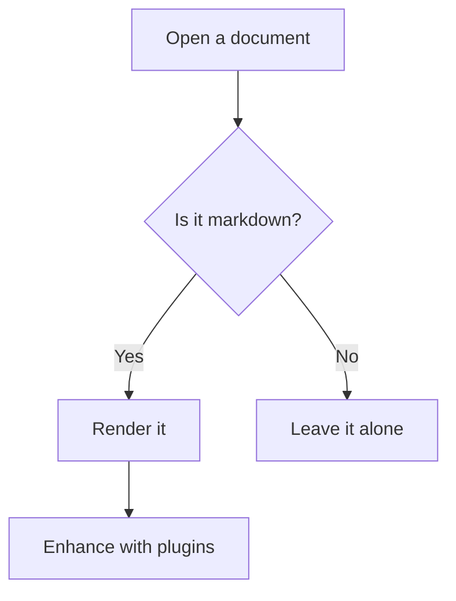
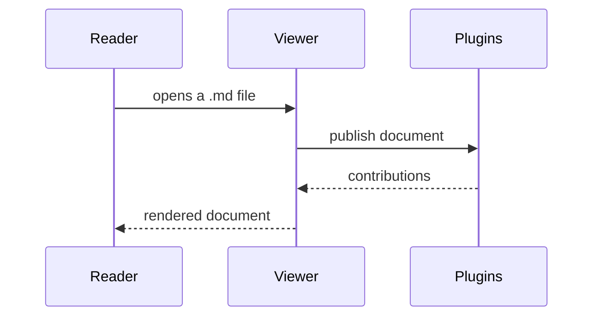

# Manual Test Document

Open this in the viewer and work down `docs/testing-guide.md` beside it. Every
section here exists to exercise something specific; the guide says what you
should see.

This paragraph is here so there is prose above the first heading, and so the
reading-time estimate has something to count. It also gives quick find a common
word to match: the word **document** appears many times in this file, which is
what makes the match counter worth reading.

## Headings and the outline

The sidebar's Outline tab should list every heading below, indented by level,
and highlight the one you are reading as you scroll.

### A third-level heading

### Another third-level heading

#### A fourth-level heading

Headings deeper than four do not appear in the outline, deliberately, but still
get an id and a fold control.

##### A fifth-level heading

## Slugs, anchors and broken links

These two headings share a name and must get distinct ids:

### Options

The first one.

### Options

The second one — reachable as [#options-1](#options-1).

### Install & Setup

Punctuation is dropped but its space is not, so this is `install--setup`:
[jump to it](#install--setup).

Link types, for the external-link marker and broken-link detection:

- [An external link](https://example.com) — should get the leaving-the-page mark
- [An in-page anchor that resolves](#headings-and-the-outline) — no mark
- [An in-page anchor that does NOT resolve](#no-such-heading-anywhere) — broken
- [A relative file link](./kitchen-sink.md) — needs a folder open to check
- [An email link](mailto:someone@example.test) — never marked
- [[Kitchen Sink]] — a wikilink, which must resolve to `kitchen-sink.md`
- [[Guide.md]] — an extension already present, so the name is used as written

## Emphasis and inline

**Bold**, _italic_, **_bold italic_**, ~~strikethrough~~, `inline code`,
<mark>highlighted</mark>, <kbd>Ctrl</kbd>+<kbd>K</kbd>, H~2~O and E=mc^2^.

An autolink: <https://example.com>. A footnote reference[^note] and a second
one[^other].

[^note]: The first footnote. Hover its reference to test hover previews.
[^other]: The second footnote, so the list has more than one entry.

Emoji shortnames, resolved from bundled data and never a network call:
:rocket: :tada: :warning: :white_check_mark: :sparkles:

An unknown shortname must survive untouched: :definitely_not_an_emoji:

## Lists

- First item
- Second item
  - Nested once
    - Nested twice
- Third item

1. One
2. Two
   1. Two point one
   2. Two point two
3. Three

Task lists, which are hand-emitted because markdown-it is CommonMark:

- [x] A completed task
- [ ] An incomplete task
  - [x] A nested completed task

## Alerts

> [!NOTE]
> Useful information the reader should notice even when skimming.

> [!TIP]
> An optional shortcut.

> [!IMPORTANT]
> Something required to achieve the outcome.

> [!WARNING]
> Something that needs immediate attention.

> [!CAUTION]
> A risk or a negative consequence.

## Containers

:::note
A note container, the MkDocs and VitePress spelling.
:::

:::tip
A tip container.
:::

:::warning
A warning container.
:::

## Code

Inline: `const x = 1;` — inline code is counted as prose by reading time.

```js
// Syntax highlighting, and the copy button
function greet(name) {
  const parts = [1, 2, 3].map((n) => n * 2);
  return `Hello, ${name}! ${parts.join(', ')}`;
}
```

```python
class Widget:
    """Docstring."""
    def __init__(self, size: int = 0) -> None:
        self.size = size
```

```
A fenced block with no language. Must still get a copy button.
```

```definitely-not-a-real-language
An unknown language must fall back to plain text, not crash.
```

    An indented code block. Math inside it must not render: $$x^2$$

## Math

Inline math: the identity $e^{i\pi} + 1 = 0$ sits in a sentence.

Display math:

$$
\int_{-\infty}^{\infty} e^{-x^2}\,dx = \sqrt{\pi}
$$

Math must **not** be read inside code. All of these stay literal:

- A code span: `$x$`
- Prose dollars: It costs $5 and $10.
- A `$` opening before a code span and closing after: A $ B `c` D $ E

## Diagrams





## Tables

A sortable table. Numbers must sort numerically — `10` after `9`, not before:

| Name    | Size | Released   | Status   |
| :------ | ---: | :--------- | :------- |
| Alpha   |    9 | 2024-03-01 | stable   |
| Bravo   |   10 | 2023-11-15 | stable   |
| Charlie | 1200 | 2025-01-30 | beta     |
| Delta   |   -2 | 2022-07-04 | archived |
| Echo    |      | 2024-12-25 | draft    |

A table with a spanning cell, which must **not** be sortable:

| Feature | Support        ||
| ------- | ------- | ------ |
| Sorting | Yes     | Stable |
| Spans   | No      | —      |

A wide table, which must scroll inside itself rather than the page:

| col1 | col2 | col3 | col4 | col5 | col6 | col7 | col8 | col9 | col10 | col11 | col12 |
| ---- | ---- | ---- | ---- | ---- | ---- | ---- | ---- | ---- | ----- | ----- | ----- |
| aaaaaaaaaa | bbbbbbbbbb | cccccccccc | dddddddddd | eeeeeeeeee | ffffffffff | gggggggggg | hhhhhhhhhh | iiiiiiiiii | jjjjjjjjjj | kkkkkkkkkk | llllllllll |

## Images

An image that resolves, for the lightbox:


A second image, so the lightbox has a gallery to navigate:


A linked image, which must follow its link rather than open the lightbox:

[](#images)

A broken image, which must degrade rather than break the layout:


## Quotes and rules

> A blockquote.
>
> > Nested, containing `code` and **bold**.

---

## Presentation

The horizontal rule above is a slide separator. With `slideSplit` set to `auto`
this document splits on rules, because it has some.

---

## Sanitization

None of the following may execute or survive. If you see a dialog, or the page
goes blank, stop and report it.

<script>window.__XSS_SCRIPT = true;</script>


<a href="javascript:window.__XSS_HREF = true">a javascript: link</a>

<iframe src="https://example.com"></iframe>

<div onclick="window.__XSS_CLICK = true">a div with a click handler</div>

<form action="https://example.com"><input name="x"><button>submit</button></form>

<style>body { display: none !important; }</style>

## Malformed input

Unclosed emphasis: **bold that never closes

A ragged table:

| a | b |
| --- |
| 1 | 2 | 3 |

An unclosed fence follows, which swallows the rest of the document. That is
correct CommonMark behaviour, so this section is deliberately last.

```js
const dangling = true;
